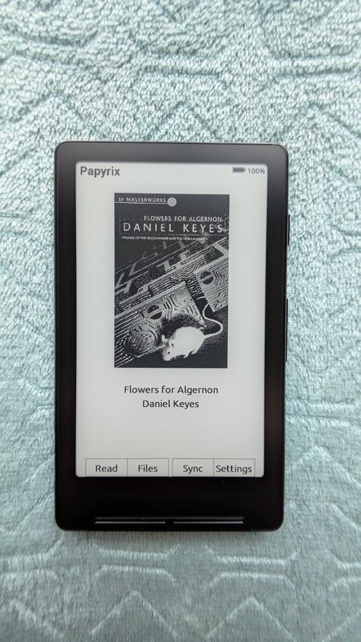

# PapyriX


PapyriX is firmware for Xteink X3, X4, X4 Pro, X4 v2 Classic, Seeed reTerminal Sticky, and Murphy M4 e-paper readers. X3/X4 use one ESP32-C3 image. Pro, Classic, Sticky, and Murphy M4 use separate ESP32-S3 images.

> **Warning:** Some Xteink units (for example, units from AliExpress) lock USB flash.
> If USB flash is locked, you cannot update or recover through USB.
> Install, update, and do [emergency recovery](#emergency-recovery) from the SD card.
> Flash through USB only on devices that have unlocked USB.



This project is **not affiliated with Xteink**. It is a community project.

## Documentation

- **Use:** [User Guide](docs/user_guide.md), [Troubleshooting](docs/troubleshooting.md), [Customization](docs/customization.md), [Fonts](docs/fonts.md), [Localization](docs/localization.md)
- **Transfer:** [Web UI](docs/webserver.md), [Calibre](docs/calibre.md), [LocalSend](docs/localsend.md), [Printer](docs/printer.md)
- **Develop:** [Architecture](docs/architecture.md), [Rendering](docs/rendering-pipeline.md), [File Formats](docs/file-formats.md), [Changelog](CHANGELOG.md)
- **Hardware:** [Device Support](docs/device-support-matrix.md), [Specifications](docs/device-specifications.md), [SSD1677 Driver](docs/ssd1677-driver.md)

## Supported devices

- **[Xteink X4 (original)](docs/x4-specifications.md)**
  - Release file: `papyrix-xteink-c3.bin`
  - Panel: 800×480 SSD1677
- **[Xteink X3](docs/x3-specifications.md)**
  - Release file: `papyrix-xteink-c3.bin`
  - Panel: 792×528 UC8253 or UC8279
- **[Xteink X4 Pro](docs/x4pro-specifications.md)**
  - Release file: `papyrix-x4pro.bin`
  - Panel: 800×480 UC8279 or UC8179
- **[Xteink X4 v2 Classic](docs/x4-classic-specifications.md)**
  - Release file: `papyrix-x4c.bin`
  - Panel: 800×480 SSD1677, UC8179, or UC8279

- **[Seeed reTerminal Sticky](docs/sticky-specifications.md)**
  - Status: implemented, not device-tested
  - App update: `papyrix-sticky.bin`
  - First installation: `papyrix-sticky-install.zip`
  - Panel: 800×480 SSD1677 or SSD2677

- **[Murphy M4](docs/murphy-m4-specifications.md)**
  - Status: **Implemented, not device-tested**
  - App update: `papyrix-murphy-m4.bin`
  - First installation: `papyrix-murphy-m4-install.zip`
  - Panel: 800×480 SSD1677
  - Physical operation and stock restoration remain unverified.

See the [device support matrix](docs/device-support-matrix.md) for build targets and hardware services. Using the wrong binary can drive incorrect pins and can damage hardware.

Page caches use profile-specific folders. Moving an SD card between supported devices does not reuse incompatible rendered pages.

## Devices tested on hardware

- Xteink X3
- Xteink X4 (original)
- Xteink X4 Pro
- Xteink X4 v2 Classic

## Features

### Reading & Format Support

- EPUB 2 and EPUB 3 with CSS formatting
- FB2 metadata, navigation, and formatted text
- HTML, Markdown, and plain text
- Native XTC and XTCH pages
- Saved reading position and recent books
- Reading progress, time, and sessions for each book
- Bookmarks saved on the SD card
- Book covers in JPEG, PNG, and BMP formats
- Table of contents navigation
- JPEG, PNG, and BMP images in EPUB

See [format behavior](docs/user_guide.md#format-behavior) and [image limits](docs/images.md#supported-formats).

### Text & Display

- Adjustable font size, paragraph alignment, indent, and spacing
- Soft hyphens and language-specific Liang-pattern hyphenation
- Built-in fonts for Vietnamese, Thai, Greek, and Arabic
- CJK text layout with external fonts for book text only, not the UI
- Thai mark placement
- Arabic contextual forms, ligatures, and right-to-left layout
- Justified text with Knuth–Plass line breaking
- Switchable text antialiasing for built-in and custom fonts
- Configurable pages per refresh
- Sunlight fading protection through display power-off after refresh
- Cached turbo LUTs for X3 page turns
- Four screen orientations
- Touch controls on X4 Pro, Sticky, and Murphy M4
- Front-light brightness and warmth on X4 Pro and Murphy M4

See [reader and screen settings](docs/user_guide.md#35-settings) and [font coverage](docs/fonts.md#built-in-font-coverage).

### Customization

- Custom themes
- Custom fonts from the SD card
- Dark, Light, Custom, Cover, and Keep Page sleep screens
- Side and front button remapping
- Short Power-button actions for page turns, bookmarks, or sleep

See [Customization](docs/customization.md), [sleep screens](docs/user_guide.md#37-sleep-screen), and [example files](docs/examples/).

### Applications

- Image Viewer and slideshow
- Clock with multiple faces
- Pomodoro timer
- [2048](docs/user_guide.md#312-2048) with button and touch controls, and saved games
- [Go 9×9](docs/user_guide.md#313-go) against an offline opponent, with button and touch controls

The [Apps menu](docs/user_guide.md#apps) groups file transfer, common apps, and games.

### Network & Connectivity

- [WiFi file transfer](docs/webserver.md) through the web interface
- [Calibre Wireless Device](docs/calibre.md) for books from Calibre desktop
- [LocalSend receiver](docs/localsend.md) for files from the LocalSend app
- [AirPrint-compatible network printer](docs/printer.md) with printouts saved on the SD card

### Maintenance

- Cache, trash, storage, and factory-reset cleanup actions
- Firmware updates from the SD card
- System information for version, uptime, memory, and storage

See [maintenance settings](docs/user_guide.md#cleanup) before deleting data.

### File System

- exFAT and FAT32 SD cards
- Web UI uploads with supported UTF-8 filenames
- File browser with nested folders
- Recycle bin for deleted files
- Hidden system folder filter

CJK filenames are not supported. See [filename rules](docs/webserver.md#unicode-filenames) and [file operations](docs/user_guide.md#file-browser).

### Installing & Firmware Updates

> Do you need to recover a device that does not start? [Go to emergency recovery](#emergency-recovery).

Use the image listed for your device under [Supported devices](#supported-devices).

For first installation, follow the [Sticky procedure](docs/sticky-specifications.md#installation) or the [Murphy M4 procedure](docs/murphy-m4-specifications.md#installation). It replaces stock firmware and can erase device data. Save full-flash and SD backups first. Stock restoration remains unverified.

For M4, confirm the model, hardware batch, flash/layout, and security state before any write. Keep a private, verified 16 MiB flash backup and a separate SD backup. No M4 device is available for physical checks.

Pro, Classic, Sticky, and Murphy M4 images are not interchangeable. Do not erase the chip or install a full-flash image from another device. For Classic partition and OTA-slot requirements, see the [Classic specifications](docs/x4-classic-specifications.md#installation).

Select the image for the correct board and partition layout. An image for the wrong board can pass validation and damage hardware. See [update compatibility](docs/device-support-matrix.md#firmware-update-compatibility) for the validation rules and limits.

For X3 and the original X4, use **[papyrix-flasher](https://github.com/bigbag/papyrix-flasher)**. USB flashing requires an unlocked device. Do not flash an S3 image to a C3 device or a C3 image to an S3 device.

```bash
papyrix-flasher flash papyrix-xteink-c3.bin
```

**SD app updates:** Follow the [normal update procedure](docs/user_guide.md#firmware-update). It requires an existing compatible PapyriX installation. It does not install PapyriX over Sticky or Murphy M4 stock firmware. Do not remove power or the SD card during an update.

#### Emergency Recovery

Emergency recovery requires bootable PapyriX and working SD access. It cannot restore an erased bootloader or damaged partition table.

Follow [firmware recovery](docs/troubleshooting.md#firmware-recovery) when the UI cannot start. The procedure includes image selection, file handling, and retry limits. Do not remove power or the SD card during recovery.

## Development

### Prerequisites

* **PlatformIO Core** (`pio`) or **VS Code + PlatformIO IDE**
* Python 3.12+ with [uv](https://docs.astral.sh/uv/) (for font conversion)
* Node.js 18+ (for sleep screen scripts and logo scripts)
* USB-C data cable
* A supported device with unlocked flashing, for upload and hardware checks

Install Node.js dependencies (for sleep screen scripts and logo scripts):
```bash
cd scripts && npm install
```

### Using Nix

If you have [Nix](https://nixos.org/), `shell.nix` supplies all dependencies:

```bash
# Enter development environment
nix-shell

# Or run commands directly
nix-shell --run "make build"
nix-shell --run "make check"
```

First-time Nix setup:
```bash
# Install Nix (if not installed)
sh <(curl -L https://nixos.org/nix/install) --daemon

# Add nixpkgs channel
nix-channel --add https://nixos.org/channels/nixos-unstable nixpkgs
nix-channel --update
```

### Checking out the code

PapyriX uses PlatformIO to build and flash the firmware. Clone the repository:

```
git clone --recursive https://github.com/bigbag/papyrix-reader

# Or, if you've already cloned without --recursive:
git submodule update --init --recursive
```

### Building

Run host tests before you build firmware. Host tests require CMake 3.16 or later, Make, C and C++17 compilers, and the Expat development library.

CMake downloads pngle 1.0.2 and checks its archive hash on the first configuration. The download requires network access. CMake keeps the source in `test/build/_deps` for later builds. Host tests do not require PlatformIO packages.

```sh
# Build and run host tests
make test

# Build development firmware for X3/X4
make build

# Build development firmware for X4 Pro
pio run -e x4pro

# Build development firmware for X4 v2 Classic
pio run -e x4c

# Build development firmware for Sticky
pio run -e sticky

# Build development and release firmware for Murphy M4
pio run -e murphy_m4 -e release_murphy_m4

# Build all five release environments
make release

# Build, verify, and package deterministic release files in dist/
make package
```

### Flashing your device

For Sticky, use the [complete first-install bundle](docs/sticky-specifications.md#installation). Sticky uses the CH343P UART0 serial port, not native USB-Serial/JTAG.

For M4, use its [first-install guide](docs/murphy-m4-specifications.md#installation). M4 uses native USB-Serial/JTAG, not the Sticky UART bridge.

The commands below apply to Xteink devices.

Connect the device through unlocked USB. Build and flash the release firmware for the device:

```sh
make flash-xteink-c3  # X3 and X4
make flash-x4pro      # X4 Pro
make flash-x4c        # X4 v2 Classic
```

X4 Pro USB flashing does not require holding Power. Close the serial monitor before flashing. To select a port:

```sh
PLATFORMIO_UPLOAD_PORT=/dev/ttyACM0 make flash-x4pro
```

`make flash-release` and `make upload-release` select X3/X4 only. The following commands update only the application at `0x10000`. Use them only when the device partition table matches and this slot is selected for boot. Use esptool 5.4 or later.

```sh
# ESP32-C3: X3/X4
esptool --chip esp32c3 --port /dev/ttyACM0 --baud 460800 \
  write-flash -z 0x10000 papyrix-xteink-c3.bin

# ESP32-S3: X4 Pro
esptool --chip esp32s3 --port /dev/ttyACM0 --baud 460800 \
  write-flash -z 0x10000 papyrix-x4pro.bin

# ESP32-S3: X4 v2 Classic
esptool --chip esp32s3 --port /dev/ttyACM0 --baud 460800 \
  write-flash -z 0x10000 papyrix-x4c.bin
```

PlatformIO upload remains available for a connected development target:

```sh
pio run -e default --target upload
pio run -e x4pro --target upload
pio run -e x4c --target upload
```

Replace `/dev/ttyACM0` with the device port. Use `COM3` on Windows or `/dev/tty.usbmodem*` on macOS where applicable.

### Build Scripts

Build scripts are in the `scripts/` directory.

#### Converting fonts

See [custom font conversion](docs/customization.md#converting-fonts) for `.epdfont` files. See [built-in font regeneration](docs/fonts.md#regenerating-built-in-fonts) for C headers and font hashes.

#### Creating sleep screen images

Create a BMP from an image:

```bash
make sleep-screen INPUT=photo.jpg OUTPUT=sleep.bmp ARGS='--bits 8'
```

See [sleep image conversion](docs/customization.md#custom-sleep-screens) for options. See [sleep screen setup](docs/user_guide.md#37-sleep-screen) for SD locations and device settings.

#### Converting logo

Convert an image to a C header for the firmware logo (384x384 monochrome):

```bash
cd scripts && node convert-logo.mjs ../images/logo-light.jpg ../src/images/PapyrixLogo.h
```

Options: `--invert`, `--threshold <0-255>`, `--rotate <0|90|180|270>` (default: `270`)

#### Calibre simulators (development/testing)

See the [library testing guide](lib/Calibre/README.md#testing) for device and desktop simulators.

#### Serial monitor

The standalone Go monitor reads device logs without PlatformIO. Download it from [Releases](https://github.com/bigbag/papyrix-reader/releases), or build it:

```bash
cd tools/monitor && go build -o monitor .
```

```bash
./monitor -port /dev/ttyACM0 -log out.txt
```

Omit `-port` for automatic port selection. Use `-speed` to change the default 115200 baud rate. See [serial log capture](docs/troubleshooting.md#serial-log-capture) for reconnecting capture.

#### Reader test (desktop)

The desktop tool runs EPUB, FB2, HTML, TXT, and Markdown parsers without flashing a device.

```bash
make reader-test FILE=book.epub OUTPUT=/tmp/cache
```

See [desktop parser checks](docs/architecture.md#desktop-parser-tool) for text dumps, batch parsing, and cache comparison.

### Creating a GitHub release

```sh
# With auto-generated notes from commits
make gh-release VERSION=0.1.1

# With custom notes
make gh-release VERSION=0.1.1 NOTES="Release notes here"
```

### Generating changelog

Make `CHANGELOG.md` from git tags and commit history:

```sh
make changelog
```

This makes a changelog grouped by version tags, with commit messages and author data.

## Internals

PapyriX retains the low-memory ESP32-C3 path. ESP32-S3 targets also use PSRAM for selected reader buffers. See the [architecture](docs/architecture.md) and [S3 reader platform](docs/s3-platform.md).

### Data caching

The device caches book data on the SD card. Each model uses a [device-specific cache directory](docs/device-specifications.md#storage).

To clear cached data, use **Settings > Cleanup** (see [User Guide](docs/user_guide.md)). Clearing the book cache also removes reading progress. Deleting the entire `.papyrix` directory also removes reading history.

The cache does not clear automatically when you delete a book. If you move a book file, the device uses a new cache directory. This resets the reading progress.

See [file formats](./docs/file-formats.md) for cache records. See the [rendering pipeline](./docs/rendering-pipeline.md#page-cache) for cache scheduling and ownership.

## Related Tools

- [EPUB to XTC Converter](https://github.com/bigbag/epub-to-xtc-converter) converts books in a browser. It provides device presets, font selection, and batch export. [Open the web app](https://liashkov.site/epub-to-xtc-converter/).
- [EPUB Optimizer](https://github.com/bigbag/xteink-epub-optimizer) prepares EPUB files for X4 display and memory limits. It also converts books to XTC and XTCH.

## Contributing

1. Fork the repository.
2. Create a branch.
3. Make the changes.
4. Run `make test`, `make format`, and `make check`.
5. Inspect formatter changes.
6. Submit a pull request.

For documentation, comments, and docstrings:

- Write one idea per sentence.
- Group related sentences into paragraphs. Separate topics with blank lines, not a new source line for every sentence.
- Name the actor and use active voice.
- Use present tense for current behavior and imperative verbs for instructions.
- Use approved STE words in their approved meaning and part of speech. Keep permitted technical terms, API names, UI labels, paths, and flags exact.
- Keep procedural sentences within 20 words and descriptive sentences within 25 words.
- Keep paragraphs within six sentences.
- Remove filler, cliches, and unsupported claims.
- Put safety conditions before the affected action.
- Keep one full source for each procedure or changing fact. Check links when headings or files change.

Preserve the meaning and time of historical events. Do not rewrite release history, quotations, legal text, or upstream attribution to force present tense.

---

PapyriX is a fork of [CrossPoint Reader](https://github.com/daveallie/crosspoint-reader) by Dave Allie.

The IPP print server core ([lib/Ipp](lib/Ipp)) comes from the [crosspoint-reader fork](https://github.com/NishantJoshi00/crosspoint-reader) by [Nishant Joshi](https://nishantjosh.dev), commit [`df0d5e3`](https://github.com/NishantJoshi00/crosspoint-reader/commit/df0d5e367b08e206ab914dcff10a2d255d67bcdb).

X4 hardware data comes from [bb_epaper](https://github.com/bitbank2/bb_epaper) by Larry Bank.

Markdown parse uses [MD4C](https://github.com/mity/md4c) by Martin Mitáš.

CSS parser is adapted from [microreader](https://github.com/CidVonHighwind/microreader) by CidVonHighwind.

**Not affiliated with Xteink or a manufacturer of the X4 hardware**.
