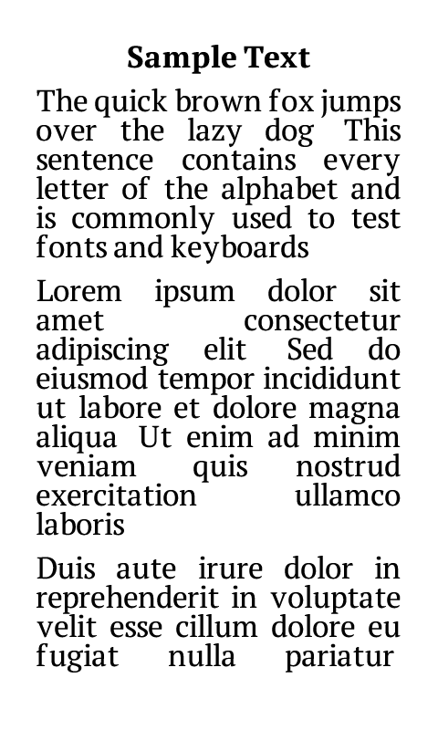
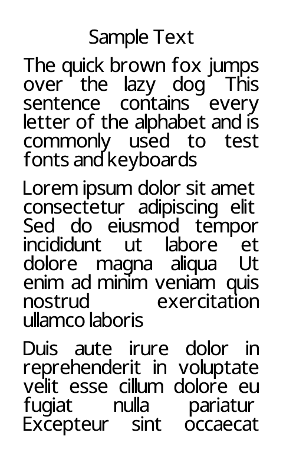

# Fonts

PapyriX Reader supports custom fonts for reading. Convert fonts to the proprietary `.epdfont` format for e-paper displays.

## How Fonts Work

### Streaming Font System

Custom fonts stream glyph bitmaps from the SD card when needed. The device does not keep the full font in RAM. This saves approximately **50KB of RAM for each font**.

- The device loads **glyph metadata** (character metrics, positions) into RAM.
- It reads **glyph bitmaps** (the pixels) from the SD card when needed.
- An **LRU cache** keeps recently used glyphs in memory.
- Usual RAM use is approximately 25KB for each font, compared to approximately 70KB for fonts that are fully loaded.

### Supported Styles

Custom `.epdfont` fonts support **regular** and **bold** styles:

- **Regular** (`regular.epdfont`) - Required. Loaded when the book is opened.
- **Bold** (`bold.epdfont`) - Optional. Loaded when bold text occurs the first time. This saves approximately 42KB of RAM for books that do not use bold.
- **Italic** text uses the regular variant. When you use built-in fonts, the native italic is used.

### Fallback Behavior

If a custom font fails to load, the device uses the built-in font. If an individual glyph fails or an SD card read error affects it, the device skips that character and continues reading. If characters are missing, try a different font in Settings. The built-in font remains available.

### Built-in Font Coverage

The built-in fonts include native support for:

- **Latin** - Western European languages and Eastern European languages, including Vietnamese diacritics
- **Cyrillic** - Russian, Ukrainian, and other languages that use Cyrillic script
- **Thai** - Full Thai script with correct mark positions
- **Greek** - Modern Greek alphabet
- **Arabic** - Arabic script with contextual shaping and RTL layout

You do not need custom fonts for these scripts. They operate immediately.

### Filename display coverage

The device file browser uses the built-in UI font. Web-created filenames are supported for Latin (including Vietnamese), Cyrillic, Greek, Thai, and Arabic. CJK `.bin` fonts are available for book text only. They are not used in UI rendering. Web UI create, upload, and rename operations reject CJK filenames.

## Font Samples

### PT Serif

- **Styles**: Regular, Bold
- **License**: OFL (Open Font License)



### Bookerly

- **Styles**: Regular, Bold, Italic
- **License**: Proprietary (Amazon)


### Literata

- **Styles**: Regular, Bold, Italic
- **License**: OFL (Open Font License)


### Noto Serif

- **Styles**: Regular
- **License**: OFL (Open Font License)


### Noto Sans

- **Styles**: Regular, Italic (Variable font)
- **License**: OFL (Open Font License)



### Roboto

- **Styles**: Regular, Italic (Variable font)
- **License**: Apache 2.0


### Ubuntu

- **Styles**: Regular, Bold, Italic
- **License**: Ubuntu Font License


### OpenDyslexic

- **Styles**: Regular, Bold, Italic
- **License**: OFL (Open Font License)


### Noto Sans Arabic

A sans-serif font with full Arabic script support, including contextual shaping and ligatures.

- **Styles**: Regular, Bold
- **Theme**: `light-arabic.theme`
- **License**: OFL (Open Font License)

### IBM Plex Sans Arabic

This font supports Arabic presentation forms used by the PapyriX Arabic shaper.

- **Styles**: Regular, Bold
- **Theme**: `light-ibm-plex-arabic.theme`
- **License**: OFL (Open Font License)

### CJK Fonts (Chinese/Japanese/Korean)

For CJK texts, PapyriX uses external `.bin` format fonts. These fonts stream from the SD card because they are large. The `.bin` format uses direct codepoint indexing (1-bit bitmap, MSB first) for the full BMP range (U+0000-U+FFEF).

> **Note:** CJK fonts are supported for book text (reading view) only. UI elements (home screen, status bar, book title overlay) use built-in bitmap fonts that do not include CJK glyphs.

#### Quick Start with gen_cjk_theme.sh

`gen_cjk_theme.sh` creates a `.bin` font and a matching `.theme` file. The script downloads `fontconvert-bin` if no local build exists:

```bash
# CJK font renders everything (Latin + CJK)
./scripts/gen_cjk_theme.sh --cjk MyCJKFont.otf --latin-mode cjk --name my-cjk-font

# Separate Latin font for ANSI, CJK font for ideographs
./scripts/gen_cjk_theme.sh --cjk MyCJKFont.ttf --latin MySerifFont.ttf --name my-mixed-font

# CJK only, builtin system font handles Latin
./scripts/gen_cjk_theme.sh --cjk MyCJKFont.otf --latin-mode system --name my-cjk-font
```

#### Manual Conversion with fontconvert-bin

For one-size conversion or custom options, use the Go converter:

```bash
# Build from source (requires Go) — one-time
make fontconvert-bin

# Or let gen_cjk_theme.sh auto-download the pre-built binary (no Go needed)

# Basic CJK conversion
tools/fontconvert-bin/build/fontconvert-bin MyCJKFont.ttf --pixel-height 34 --name my-cjk -o /tmp/

# With separate Latin font
tools/fontconvert-bin/build/fontconvert-bin MyCJKFont.ttf --pixel-height 34 --latin-font Latin.ttf --name mixed -o /tmp/

# CJK only (builtin handles Latin)
tools/fontconvert-bin/build/fontconvert-bin MyCJKFont.ttf --pixel-height 30 --cjk-only --name cjk -o /tmp/
```

Options:
- `--size N` — Font size in points (default: 20)
- `--pixel-height N` — Pixel height (overrides --size/--dpi)
- `--name NAME` — Font name for output
- `--latin-font FILE` — Separate font for Latin (U+0000-U+024F)
- `--latin-size N` — Pixel height for Latin font
- `--cjk-only` — Zero Latin range, empty slots fall through to builtin
- `-o DIR` — Output directory
- `--dpi N` — Rendering DPI (default: 150)
- `--max-codepoint N` — Highest codepoint (default: 0xFFEF)

#### CJK Font Format Details

- **Direct codepoint indexing**: `offset = codepoint * bytesPerChar`
- **1-bit bitmap**, MSB first, `bytesPerRow = (W+7)//8`
- **Cell dimensions**: calculated from sample CJK characters, maximum 64x64
- **Cell size constraint**: maximum 512 bytes/glyph (64x64 at 1-bit)
- **Filename encodes metadata**: `{name}_{size}_{W}x{H}.bin` or `{name}_px{height}_{W}x{H}.bin`
- **Glyph filtering**: finds Latin glyph reuse (font mapping defects), skips narrow ideographs (less than 20% cell width)

#### Latin Handling Modes

- **`cjk`**
  - Description: CJK font shows Latin + CJK
  - When to use: Font has good Latin glyphs
- **`include`**
  - Description: Separate Latin font for U+0000-U+024F
  - When to use: You want different Latin/CJK fonts
- **`system`**
  - Description: Builtin font handles Latin, `.bin` for CJK only
  - When to use: You want builtin Latin rendering

## Converting and Installing Fonts

See the [Customization Guide](customization.md#custom-fonts) for the full procedure to convert TTF/OTF fonts to `.epdfont` format and install them on your device.

## Font Sources

- [Google Fonts](https://fonts.google.com/) - Free, open-source fonts
- [Noto Fonts](https://fonts.google.com/noto) - Support for many languages

## Regenerating built-in fonts

Obtain static TTF files and place them at the paths below before you run these commands. After you regenerate a header, update its `*_FONT_ID` hash in `src/config.h`. Use the command in the comment above that hash.

Use these fallback files:

```bash
FALL_R="fonts/Noto_Sans_Thai/static/NotoSansThai-Regular.ttf fonts/Noto_Sans_Arabic/static/NotoSansArabic-Regular.ttf"
FALL_B="fonts/Noto_Sans_Thai/static/NotoSansThai-Bold.ttf fonts/Noto_Sans_Arabic/static/NotoSansArabic-Bold.ttf"
FALL_V_R="fonts/Noto_Sans/static/NotoSans-Regular.ttf"
FALL_V_B="fonts/Noto_Sans/static/NotoSans-Bold.ttf"
```

The reader uses 2-bit Roboto fonts:

```bash
uv run scripts/fontconvert.py reader_xsmall_regular_2b 12 fonts/Roboto/static/Roboto-Regular.ttf $FALL_R --2bit --thai --arabic > lib/EpdFont/src/builtinFonts/reader_xsmall_regular_2b.h
uv run scripts/fontconvert.py reader_xsmall_bold_2b 12 fonts/Roboto/static/Roboto-Bold.ttf $FALL_B --2bit --thai --arabic > lib/EpdFont/src/builtinFonts/reader_xsmall_bold_2b.h
uv run scripts/fontconvert.py reader_xsmall_italic_2b 12 fonts/Roboto/static/Roboto-Italic.ttf $FALL_R --2bit --thai --arabic > lib/EpdFont/src/builtinFonts/reader_xsmall_italic_2b.h
uv run scripts/fontconvert.py reader_2b 14 fonts/Roboto/static/Roboto-Regular.ttf $FALL_R --2bit --thai --arabic > lib/EpdFont/src/builtinFonts/reader_2b.h
uv run scripts/fontconvert.py reader_bold_2b 14 fonts/Roboto/static/Roboto-Bold.ttf $FALL_B --2bit --thai --arabic > lib/EpdFont/src/builtinFonts/reader_bold_2b.h
uv run scripts/fontconvert.py reader_italic_2b 14 fonts/Roboto/static/Roboto-Italic.ttf $FALL_R --2bit --thai --arabic > lib/EpdFont/src/builtinFonts/reader_italic_2b.h
uv run scripts/fontconvert.py reader_medium_2b 16 fonts/Roboto/static/Roboto-Regular.ttf $FALL_R --2bit --thai --arabic > lib/EpdFont/src/builtinFonts/reader_medium_2b.h
uv run scripts/fontconvert.py reader_medium_bold_2b 16 fonts/Roboto/static/Roboto-Bold.ttf $FALL_B --2bit --thai --arabic > lib/EpdFont/src/builtinFonts/reader_medium_bold_2b.h
uv run scripts/fontconvert.py reader_medium_italic_2b 16 fonts/Roboto/static/Roboto-Italic.ttf $FALL_R --2bit --thai --arabic > lib/EpdFont/src/builtinFonts/reader_medium_italic_2b.h
uv run scripts/fontconvert.py reader_large_2b 18 fonts/Roboto/static/Roboto-Regular.ttf $FALL_R --2bit --thai --arabic > lib/EpdFont/src/builtinFonts/reader_large_2b.h
uv run scripts/fontconvert.py reader_large_bold_2b 18 fonts/Roboto/static/Roboto-Bold.ttf $FALL_B --2bit --thai --arabic > lib/EpdFont/src/builtinFonts/reader_large_bold_2b.h
uv run scripts/fontconvert.py reader_large_italic_2b 18 fonts/Roboto/static/Roboto-Italic.ttf $FALL_R --2bit --thai --arabic > lib/EpdFont/src/builtinFonts/reader_large_italic_2b.h
```

The UI uses 1-bit Ubuntu fonts. The small status font uses Noto Sans:

```bash
uv run scripts/fontconvert.py ui_10 10 fonts/Ubuntu/Ubuntu-Regular.ttf $FALL_V_R $FALL_R --thai --arabic > lib/EpdFont/src/builtinFonts/ui_10.h
uv run scripts/fontconvert.py ui_bold_10 10 fonts/Ubuntu/Ubuntu-Bold.ttf $FALL_V_B $FALL_B --thai --arabic > lib/EpdFont/src/builtinFonts/ui_bold_10.h
uv run scripts/fontconvert.py ui_12 12 fonts/Ubuntu/Ubuntu-Regular.ttf $FALL_V_R $FALL_R --thai --arabic > lib/EpdFont/src/builtinFonts/ui_12.h
uv run scripts/fontconvert.py ui_bold_12 12 fonts/Ubuntu/Ubuntu-Bold.ttf $FALL_V_B $FALL_B --thai --arabic > lib/EpdFont/src/builtinFonts/ui_bold_12.h
uv run scripts/fontconvert.py small14 8 fonts/Noto_Sans/static/NotoSans-Regular.ttf $FALL_R --thai --arabic > lib/EpdFont/src/builtinFonts/small14.h
```
